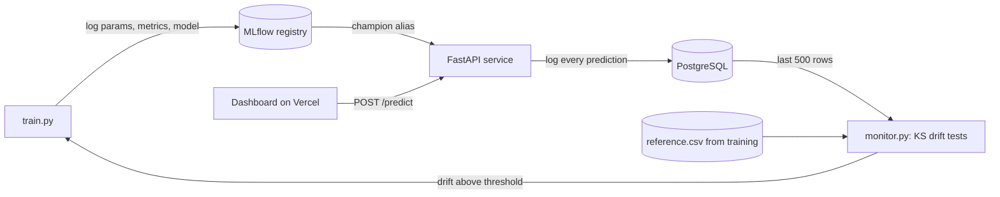

# Fraud Detection MLOps Platform

An end-to-end machine learning system: **train → track → register → serve → monitor → retrain**, with a live dashboard.

| Layer | Tech |
|---|---|
| Model | XGBoost, scikit-learn (threshold tuned for best F1) |
| Experiment tracking and model registry | MLflow (`champion` alias marks the production version) |
| Serving | FastAPI (`/predict`, `/stats`, `/drift`, `/retrain`) |
| Storage | PostgreSQL in production, SQLite locally (via SQLAlchemy) |
| Monitoring | Per-feature Kolmogorov-Smirnov drift tests on live traffic, optional Evidently HTML report |
| CI/CD | GitHub Actions (tests, Docker build, weekly drift check and auto-retrain) |
| Frontend | Static dashboard (HTML/JS) deployed on Vercel |
| Packaging | Docker, docker-compose |

## Architecture



## Results (synthetic data, ~3% fraud rate, hold-out set)

| Precision | Recall | F1 | PR-AUC | ROC-AUC |
|---|---|---|---|---|
| ~0.67 | ~0.81 | ~0.73 | ~0.78 | ~0.99 |

Exact numbers vary slightly per run and are stored in MLflow. Replace `src/data.py` with a real dataset (for example the Kaggle credit card fraud data) to benchmark on real transactions.

## Run locally (VS Code, Windows)

```powershell
python -m venv .venv
.venv\Scripts\activate
pip install -r requirements-dev.txt
python -m src.train                      # trains and registers model v1
uvicorn src.api:app --reload             # API at http://localhost:8000/docs
```

Frontend, in a second terminal:

```powershell
python -m http.server 5500 --directory frontend    # open http://localhost:5500
```

Other commands:

```powershell
mlflow ui --backend-store-uri sqlite:///mlflow.db   # experiment UI at http://localhost:5000
pytest -q                                           # run tests
python -m src.monitor                               # print a drift report
pip install evidently==0.4.40                       # optional: enables reports/drift_report.html
```

macOS/Linux: activate with `source .venv/bin/activate`.

## Run everything with Docker (API + PostgreSQL)

```bash
docker compose up --build        # API at http://localhost:8000
```

## Try the full MLOps loop in the dashboard

1. Click **Send 100 normal transactions**, then **Check drift** → no drift.
2. Click **Send 100 shifted transactions** (bigger amounts, farther away, more activity), then **Check drift** → drift detected.
3. Click **Retrain model** → a new version is trained, registered in MLflow, promoted to `champion`, and hot-reloaded by the API.

## Deploy

**Why not everything on Vercel?** Vercel runs short-lived serverless functions with a ~250 MB size limit and no persistent disk or background jobs. XGBoost + MLflow + retraining don't fit. Put the **API on Render/Railway** and the **frontend on Vercel**.

**1. Backend on Render (free tier)**
1. Push this repo to GitHub.
2. Render → New → PostgreSQL (free) → copy the *Internal Database URL*.
3. Render → New → Web Service → connect the repo → Runtime: **Docker**.
4. Environment variables:
   - `DATABASE_URL` = the Postgres URL from step 2
   - `ADMIN_API_KEY` = a long random string
   - `CORS_ORIGINS` = your Vercel URL (set after step 2 below; use `*` while testing)
5. Health check path: `/health`. Copy the service URL, for example `https://fraud-mlops-api.onrender.com`.

The free tier sleeps after inactivity, so the first request can take ~30 seconds.

**2. Frontend on Vercel**
1. Edit `frontend/config.js` and set `window.API_URL` to your Render URL. Commit and push.
2. Vercel → Add New Project → import the repo.
3. **Root Directory: `frontend`**, Framework Preset: **Other**, no build command. Deploy.
4. Go back to Render and set `CORS_ORIGINS` to your Vercel URL.

**3. CI/CD**: `.github/workflows/ci.yml` runs tests and a Docker build on every push. Add a `DATABASE_URL` repo secret to enable the weekly scheduled drift check that retrains automatically.

## Project structure

```
src/
  config.py    settings and environment variables
  data.py      synthetic transaction generator
  train.py     training pipeline, MLflow logging, model registry
  api.py       FastAPI service
  db.py        SQLAlchemy models (prediction log)
  monitor.py   drift detection and retrain trigger
tests/         API and monitoring tests
frontend/      dashboard (static, deploy to Vercel)
Dockerfile, docker-compose.yml, .github/workflows/ci.yml
```

## API

| Endpoint | Purpose |
|---|---|
| `POST /predict` | Score a transaction, returns probability, decision, model version, latency |
| `GET /model` | Metadata and metrics of the serving model |
| `GET /stats` | Prediction counts, flag rate, latency, recent predictions |
| `GET /drift` | Drift test results on the last 500 predictions |
| `POST /retrain` | Retrain and promote a new model (requires `X-API-Key`) |
| `GET /health` | Liveness check |

## Limitations and next steps

- Retraining uses simulated fresh data. In production, pull recently labelled transactions from a warehouse or feature store.
- Fraud labels arrive late in real life, so monitor input drift first and add performance monitoring once labels land.
- Add authentication on `/predict`, request-level rate limiting, and a champion/challenger comparison before promoting a model.
